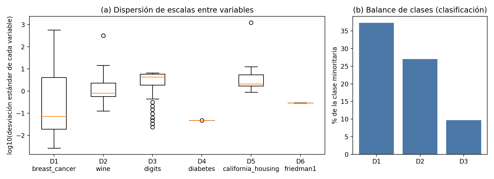
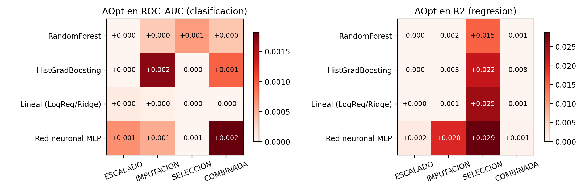
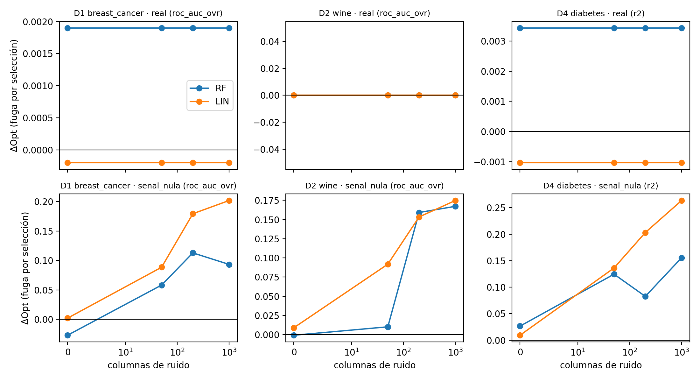

# Auditoría y prevención de fuga de datos en pipelines de Machine Learning generados por LLM

**Informe de avance — Entrega Final de Capstone Project I**
Magíster en Data Science · Universidad de Las Américas
Autor: Witman Zavala Muñoz · Profesor Guía: Francisco Pérez · Co-guía: no aplica · Octubre de 2026

> **VERSIÓN FUENTE EN LaTeX:** la versión para entregar está en `latex/informe_EF.tex` (PDF: `latex/informe_EF.pdf`). Este Markdown queda como borrador de lectura.
>
> **Nota de formato (borrar antes de entregar).** Este texto está en Markdown para poder editarlo en VS Code. Debe pasarse a la
> plantilla UDLA (`udla-capstone.cls`, en `tesis_consolidada_v3/…/latex/`). Estimación: ≈ 5.700 palabras + 5 tablas + 4 figuras
> ≈ 16–18 páginas de cuerpo (la rúbrica v2 exige **15–20**, sin portada, referencias ni anexos). Mídalo en la plantilla.
> Todas las cifras salen de `04_experiments/results/` y se regeneran con `python ejecutar_todo.py`.

---

## 1. Introducción y formulación del problema

### 1.1 Contexto

Los asistentes de programación basados en modelos de lenguaje grande (LLM) ya escriben pipelines completos de ciencia de datos (Hong et al., 2025), y los benchmarks de agentes miden su puntaje o su tasa de éxito (Chan et al., 2025; Huang et al., 2024), no la validez metodológica de lo que producen. Un código generado por un LLM puede fallar de siete formas habituales: (1) errores de sintaxis; (2) alucinación de APIs o uso de métodos obsoletos; (3) incompatibilidad de dimensiones o tipos; (4) ineficiencia o agotamiento de memoria; (5) falta de control de semillas; (6) manejo inseguro de archivos o credenciales; y (7) **fuga de datos** (*data leakage*).

¿Por qué estudiar solo la fuga? Porque es el único de los siete que **no interrumpe la ejecución**. Los fallos 1 a 4 y 6 producen una excepción o son visibles para un *linter*; el fallo 5 se detecta repitiendo la corrida. En cambio, la fuga produce un script que corre de principio a fin, entrega métricas más altas y, por eso, rara vez se cuestiona (Tabla 1). La evidencia de que el problema es grave en la práctica humana es amplia: Kapoor y Narayanan (2023) hallaron 294 artículos afectados por fuga en 17 campos científicos, y Kaufman et al. (2012) la formularon como información del objetivo que no estaría disponible al predecir.

**Tabla 1.** Fallos ruidosos frente a fallo silencioso en código de ML generado por LLM.

| Dimensión | Fallos ruidosos (1–4, 6) | Fuga de datos (7) |
|---|---|---|
| Comportamiento del intérprete | Lanza una excepción | Se ejecuta sin error ni advertencia |
| Detección estándar | Intérprete o *linter* | Invisible para herramientas convencionales: los tipos y dimensiones coinciden |
| Efecto sobre las métricas | No llega a producirlas | Las infla (optimismo) |
| Riesgo en producción | Bajo: el pipeline no corre | Alto: el modelo se despliega con una capacidad de generalización peor que la creída |

### 1.2 Qué es la fuga y cómo ocurre en scikit-learn

Un transformador (escalador, imputador, selector de variables, PCA) *aprende* parámetros con `.fit()`: medias y desviaciones, vecinos más cercanos, o qué variables conservar. Si aprende con **todas** las filas antes de separar entrenamiento y prueba (o fuera de un `Pipeline` dentro de una validación cruzada), ya vio las filas que luego se usan para evaluar. Formalmente, el aislamiento correcto exige que los parámetros del preprocesamiento sean función solo de los datos de entrenamiento, y hay fuga cuando algún parámetro se estima con la unión de entrenamiento y prueba. El ejemplo mínimo de la Figura 1 contrasta ambas formas con el mismo modelo, los mismos datos y los mismos pliegues.

```python
# CON FUGA: el escalador ve todas las filas
X_esc = StandardScaler().fit_transform(X)
scores = cross_val_score(modelo, X_esc, y, cv=5)

# SIN FUGA: en cada pliegue, .fit() ve solo el entrenamiento
pipe = Pipeline([("escalador", StandardScaler()), ("modelo", modelo)])
scores = cross_val_score(pipe, X, y, cv=5)
```
*Figura 1.* Misma operación con y sin fuga. (Pasar a figura numerada en la plantilla.)

Se estudian cuatro mecanismos: **escalado** (la media y la varianza incluyen filas de prueba), **imputación** (`KNNImputer` puede copiar valores de vecinos de prueba), **selección de variables** (`SelectKBest` usa las etiquetas de todas las filas, que es el más dañino en teoría) y **combinada** (los tres a la vez).

### 1.3 Problema, pregunta y relevancia

**Problema.** Un script de ML tabular puede contener fuga de datos sin que nada lo advierta, y un usuario que recibe ese código de un asistente de IA no tiene una forma barata de comprobarlo ni de saber cuánto distorsiona la evaluación.

**Pregunta de investigación.** ¿Es posible detectar automáticamente, leyendo y ejecutando el código, la fuga de preprocesamiento y selección en pipelines de scikit-learn; reparar el código sin cambiar el modelo; y cuantificar cuánto optimismo introduce la fuga en distintas familias de algoritmos?

**Relevancia.** Los detectores existentes son principalmente estáticos y se evaluaron sobre código humano (Yang et al., 2022; Drobnjaković et al., 2024; AlOmar et al., 2025), y los LLM tienen dificultades para identificar por sí mismos estos problemas tempranos del pipeline (Kumar et al., 2025). Falta un instrumento determinista que audite código de asistentes, lo repare y mida el daño; ese es el entregable de este proyecto.

### 1.4 Objetivos

**Objetivo general.** Diseñar, validar empíricamente e implementar un marco automatizado de detección y prevención de fuga de datos en pipelines de aprendizaje supervisado con scikit-learn, y cuantificar el sesgo de optimismo que induce en cuatro familias de algoritmos.

| OE | Objetivo específico (verificable) | Evidencia |
|---|---|---|
| OE1 | Formalizar los mecanismos de fuga (escalado, imputación, selección, combinada) y distinguirlos de otros fallos de código generado. | §1.1–1.2; banco de control (96 pares) |
| OE2 | Desarrollar un auditor determinista (AST + verificación en ejecución) y medir su precisión, recall y VPN contra una verdad conocida. | `03_auditor/`; Tablas 7 y 8 |
| OE3 | Cuantificar el Sesgo de Optimismo ΔOpt por tipo de fuga y familia (RandomForest, Gradient Boosting, lineal regularizado, red neuronal MLP) en 3 datasets de clasificación y 3 de regresión. | Tablas 9 y 10, Figuras 3 y 4 |
| OE4 | Entregar dos Agent Skills y una plataforma web que permitan auditar, reparar y crear pipelines sin fuga. | `05_skills/`, `06_web/` |

### 1.5 Métrica central y criterios de éxito

La métrica es el **Sesgo de Optimismo Inducido por Fuga**: `ΔOpt = M_leaky − M_clean`, donde `M` es el promedio de una métrica (ROC-AUC, F1, R² o −RMSE) en 5 pliegues, y `M_leaky` y `M_clean` provienen del mismo dataset, los mismos pliegues (semilla 42), el mismo modelo y los mismos hiperparámetros; solo cambia si el preprocesamiento se ajustó con todas las filas o dentro de un `Pipeline`. Por construcción, si no hay fuga, ΔOpt = 0. Se evita el nombre «brecha de generalización», que en el aprendizaje estadístico clásico designa la diferencia entre el desempeño de entrenamiento y el de prueba, es decir, el sobreajuste, que puede ser alto incluso sin fuga (por ejemplo, un árbol sin poda).

**Tabla 2.** Criterios de éxito operativos y resultado (detalle en §4 y §5).

| OE | Criterio (umbral o punto de comparación) | Resultado |
|---|---|---|
| OE2 | Banco de control: precisión y recall ≥ 0,90 | 1,00 y 1,00 (evaluación **circular**, ver §4.3) |
| OE2 | Evaluación independiente (13 scripts manuales): recall híbrido ≥ 0,80 y 0 falsos positivos | 9/9 y 0 FP; IC95 % exacto del recall [0,66; 1,00]: **con n = 9 no se puede afirmar** el umbral |
| OE3 | H-esc.: en árboles, ΔOpt por escalado ≈ 0 (\|ΔOpt\| < 0,001) | Confirmada: máx. 0,0002 |
| OE3 | H-MLP: la red neuronal sufre el mayor ΔOpt | **Parcial**: solo en regresión y sin significancia tras corregir por multiplicidad |
| OE4 | Reparación automática ≥ 90 % de los scripts con fuga | 96/96 en el banco; **4/9** en la evaluación independiente |

Los umbrales son propuestas del autor, formalizadas después de la prueba piloto descrita aquí; en Capstone II se fijarán antes de evaluar con pipelines de LLM reales.

### 1.6 Alcance, supuestos y restricciones

*Alcance:* clasificación y regresión supervisadas con scikit-learn sobre datos tabulares; fuga de preprocesamiento, imputación y selección de variables. El *clustering* queda fuera porque no hay objetivo explícito contra el cual medir el optimismo. *Supuestos:* datos i.i.d.; 5 pliegues con semilla fija; el generador de pares reproduce con fidelidad el mecanismo de fuga. *Restricciones:* solo datasets nativos de scikit-learn y sin anotadores humanos (observaciones del comité); sin fugas temporales ni de dominio; los pipelines escritos por LLM reales **no se han generado aún** (Capstone II).

---

## 2. Fundamentación y posicionamiento

La literatura se organiza en tres enfoques que se comparan en la Tabla 3.

**Detectores estáticos.** Yang et al. (2022) analizan el flujo de datos de notebooks para detectar patrones de fuga; Drobnjaković et al. (2024) lo formalizan con interpretación abstracta; AlOmar et al. (2025) lo llevan a una extensión de IDE. Son deterministas y reproducibles, pero ciegos a lo que depende de los valores de los datos y se validaron sobre código humano.

**LLM como detector o juez.** Draoui et al. (2026) combinan *slicing* estático con *prompts* estructurados a un LLM, y Nam et al. (2025) incorporan un agente de chequeo de fuga dentro de un agente de ingeniería de ML. El LLM como juez tiene sesgos documentados (Zheng et al., 2023) y no es reproducible, lo que lo hace inadecuado como instrumento de medición.

**Buenas prácticas.** Lones (2024) y Kapoor y Narayanan (2023) catalogan la fuga y recomiendan encapsular el preprocesamiento; ese es el criterio de «código correcto» que usa este proyecto.

**Tabla 3.** Enfoques existentes y posicionamiento del proyecto.

| Enfoque | Detecta | Mide el efecto sobre la métrica | Repara el código | Limitación principal |
|---|---|---|---|---|
| Detectores estáticos | Patrones de flujo de datos | No | No | Ciegos a fuga dependiente de valores; validados en código humano |
| LLM como detector o juez | Lo descrito en el *prompt* | No | A veces | Sesgos y variabilidad; sin evidencia trazable |
| **Este proyecto** | AST + conteo de filas en `.fit` | **Sí (ΔOpt, mismo pliegue)** | **Sí (patrones CV y Split)** | Solo scikit-learn y tabular; alcance limitado de la reparación |

**Brecha y decisiones de diseño.** Entre las fuentes revisadas, ninguna mide el optimismo con una intervención pareada ni combina lectura y ejecución del código con reparación. De allí se derivan las decisiones: (i) el **detector es determinista**, no un LLM, porque se usa como instrumento de medición y debe ser reproducible (Zheng et al., 2023); (ii) se combinan **AST y verificación en ejecución** porque el primero lee el código pero no sus valores y el segundo observa lo que ocurrió; (iii) **ΔOpt pareado** sigue la práctica de comparar una evaluación defectuosa con la corregida (Kapoor y Narayanan, 2023; Cawley y Talbot, 2010); (iv) la comparación entre familias usa pruebas no paramétricas pareadas (Demšar, 2006) porque con pocos datasets no se justifica asumir normalidad.

---

## 3. Metodología, datos y plan de trabajo

### 3.1 Metodología

Se adapta CRISP-DM a un problema de ingeniería de instrumentos de medición (Tabla 4, columna «Propósito»; el diseño sigue la lógica de *design science*, Hevner et al., 2004: construir un artefacto y evaluarlo contra una verdad conocida).

**Tabla 4.** Etapas, propósito y evidencia en el repositorio.

| Etapa (CRISP-DM adaptado) | Propósito | Objetivo | Archivo |
|---|---|---|---|
| Comprensión del problema | Fijar mecanismos de fuga y métrica | OE1 | §1; `decision_log.md` |
| Comprensión de los datos | Caracterizar los 6 datasets | OE3 | `eda_datasets.py` |
| Preparación | Ruido, faltantes y submuestreo reproducibles | OE3 | `sklearn_loader.py` |
| Modelado (del instrumento) | Generar los 96 pares; construir el auditor | OE2 | `generar_pares_controlados.py`, `03_auditor/` |
| Evaluación | Precisión/recall/VPN, ΔOpt, pruebas por familia | OE2, OE3 | `run_benchmark.py`, `statistical_analysis.py` |
| Despliegue | Skills y plataforma web | OE4 | `05_skills/`, `06_web/` |

### 3.2 Datos: origen, obtención y caracterización

Se usan seis conjuntos nativos de scikit-learn (Tabla 5): tres de clasificación (`breast_cancer`, `wine`, `digits`) y tres de regresión (`diabetes`, `california_housing`, `make_friedman1`). Son públicos, no contienen datos personales y se cargan sin copiarlos al repositorio; solo `california_housing` se descarga la primera vez. La Figura 2 resume la dispersión de escalas y el balance de clases.

**Tabla 5.** Caracterización de los datasets (`results/eda_datasets.csv`).

| ID | Dataset | Tarea | N | Variables | Razón de escalas máx/mín | Asimetría media | Clase minoritaria |
|---|---|---|---|---|---|---|---|
| D1 | breast_cancer | Clasif. (2) | 569 | 30 | 215.171 | 1,74 | 37,3 % |
| D2 | wine | Clasif. (3) | 178 | 13 | 2.530 | 0,43 | 27,0 % |
| D3 | digits | Clasif. (10) | 1.797 | 64 | 277 | 4,89 | 9,7 % |
| D4 | diabetes | Regresión | 442 | 10 | 1,0 | 0,41 | — |
| D5 | california_housing | Regresión | 3.000* | 8 | 1.398 | 10,00 | — |
| D6 | friedman1 | Regresión | 1.000 | 50 | 1,1 | 0,04 | — |

*Submuestra determinista de 3.000 filas de 20.640 (desviación B1, ver §3.4). `digits` tiene 3 columnas constantes.


*Figura 2.* (a) Dispersión de escalas entre variables, en log10 de la desviación estándar. (b) Porcentaje de la clase minoritaria en los datasets de clasificación.

**Preparación trazable.** (i) *Variante «completo»*: sin faltantes. (ii) *Variante «con_faltantes»*: se borra el 10 % de las celdas con semilla fija (media observada 9,8–10,1 %). (iii) A D1–D5 se les agregan 50 columnas de ruido gaussiano, porque la fuga por selección solo se manifiesta si hay variables inútiles entre las cuales elegir; D6 ya trae 45. Todo usa la semilla 42, y dos ejecuciones producen datos idénticos (verificado en las pruebas automáticas).

**Representatividad y limitaciones.** Son datasets clásicos, limpios, pequeños y tabulares; no representan datos reales ruidosos, de gran escala ni con estructura temporal o jerárquica. Los LLM probablemente los vieron durante su entrenamiento. Por la dispersión de escalas (Figura 2a), el escalado debería afectar sobre todo a los modelos sensibles a la escala; por la asimetría de D5 (10,0), se esperan valores atípicos que desestabilicen a la red neuronal, y así ocurrió (§3.4). Con ROC-AUC cercana a 1 en D1–D3, hay un efecto techo que limita cuánto optimismo puede observarse en clasificación.

### 3.3 Diseño experimental

Para cada combinación de 6 datasets × 4 familias × 4 tipos de fuga, un generador escribe un script con fuga (`leaky`) y otro idéntico sin ella (`clean`): **96 pares = 192 scripts**. Los modelos son `RandomForest`, `HistGradientBoosting`, `LogisticRegression`/`Ridge` y `MLPClassifier`/`MLPRegressor` (hiperparámetros en el código). Como la verdad se conoce por construcción, no se necesitan anotadores. Cada script se audita por **dos mecanismos independientes**: un análisis del árbol sintáctico (`ast`) con tres reglas (R-Split: ajuste antes de `train_test_split`; R-CV: ajuste fuera de un `Pipeline` cuyo resultado entra a la validación cruzada; R-Test: ajuste con una variable que parece de prueba) y un verificador en ejecución que cuenta con cuántas filas se ajusta cada transformador y declara fuga si coincide con el total del dataset. El detector híbrido declara fuga si cualquiera de los dos la ve.

### 3.4 Plan de trabajo actualizado y desviaciones

**Tabla 6.** Plan de trabajo (estado a octubre de 2026).

| Periodo | Actividad | Estado |
|---|---|---|
| Capstone I | Reformulación del problema y la métrica; datasets; banco de control de 96 pares; auditor AST + runtime; refactorizador; benchmark y ΔOpt; Skills y plataforma web (prototipo); informe | **Hecho** |
| Capstone II, sem. 1–4 | Generar pipelines con 6–8 LLM reales (24 tareas por modelo) y auditarlos; ejecutarlos en un entorno aislado | Pendiente |
| Capstone II, sem. 5–8 | Mejorar el auditor (alias de importación, funciones auxiliares, `ColumnTransformer`); ampliar la evaluación independiente de 13 a ≥ 60 scripts | Pendiente |
| Capstone II, sem. 9–12 | Más datasets con señal débil; intervalos bootstrap por dataset; piloto de uso con 3–5 personas | Pendiente |
| Capstone II, sem. 13–16 | Redacción de la tesis y defensa | Pendiente |

**Desviaciones respecto del plan original** (justificación completa en `07_informe/decision_log.md`):
(B1) `california_housing` se submuestrea a 3.000 filas porque `KNNImputer` crece con n² y el banco de 192 scripts no sería ejecutable en un portátil; (B2) el sobremuestreo (SMOTE) no se mide, porque no pertenece a scikit-learn, y el cuarto tipo es «combinada»; (B3) `LogisticRegression` usa `max_iter=2000`; (C1) en una primera corrida `LIN` y `MLP` se evaluaban sin escalar en las fugas de imputación y selección, lo que producía diferencias negativas por inestabilidad numérica (hasta −0,155 en `wine`); se corrigió añadiendo un escalador interno idéntico en ambas versiones, y los resultados descartados se conservan en `results/corrida1_descartada/`; (C2) un `MLPRegressor` divergió en un pliegue (R² = −21 en `california_housing`, promedio −3,86), por lo que se definió, **después de ver el problema**, que un par es degenerado si algún pliegue tiene R² < −1; se excluyó 1 par de 96, y se lista aparte.

---

## 4. Protocolo de validación y línea base

### 4.1 Protocolo para evitar la fuga en la propia evaluación

Aplicamos al experimento lo que auditamos: (i) validación cruzada de 5 pliegues (estratificada en clasificación) con semilla 42 y los **mismos pliegues** para `leaky` y `clean`; (ii) en la versión `clean` y en el código reparado, todo preprocesamiento va dentro de un `Pipeline`, de modo que se ajusta solo con el entrenamiento de cada pliegue; (iii) el verificador en ejecución comprueba que, en `clean`, ningún transformador vea tantas filas como el total (máximo observado ≈ 80 %); (iv) las pruebas estadísticas usan como unidad el **par** (dataset × tipo de fuga), no los pliegues, que no son independientes.

### 4.2 Métricas y línea base

*Del auditor* (positivo = «hay fuga»): precisión, recall, F1 y valor predictivo negativo (VPN = probabilidad de que un script declarado limpio lo sea). *Del daño*: ΔOpt en ROC-AUC (clasificación) y R² (regresión), con F1 macro y RMSE como secundarias. *Línea base:* el pipeline `clean` es el punto de comparación de ΔOpt, y los componentes por separado (solo AST y solo ejecución) son la línea base del detector híbrido. No se comparó contra un *linter* ni contra un LLM juez; queda para Capstone II.

### 4.3 Resultados: eficacia del auditor

**Tabla 7.** Banco de control: 192 scripts con verdad conocida (`auditor_confusion_matrix.csv`).

| Detector | TP | TN | FP | FN | Precisión | Recall | VPN |
|---|---|---|---|---|---|---|---|
| AST (estático) | 96 | 96 | 0 | 0 | 1,00 | 1,00 | 1,00 |
| Ejecución | 96 | 96 | 0 | 0 | 1,00 | 1,00 | 1,00 |
| Híbrido | 96 | 96 | 0 | 0 | 1,00 | 1,00 | 1,00 |

**Este 100 % no prueba que el auditor generalice**: el banco lo produce un generador escrito por el mismo autor que el auditor (evaluación circular), con patrones que este conoce. Por eso se añadió una **evaluación independiente** con 13 scripts escritos a mano (9 con fuga, 4 limpios) con estilos que el generador no produce: `make_pipeline`, DataFrames, funciones auxiliares, alias de importación, variables `X_te`, y `fit` y `transform` por separado.

**Tabla 8.** Evaluación independiente (n = 13; `evaluacion_independiente_metricas.csv`).

| Detector | TP | TN | FP | FN | Precisión | Recall | VPN |
|---|---|---|---|---|---|---|---|
| AST | 8 | 4 | 0 | 1 | 1,00 | 0,89 | 0,80 |
| Ejecución | 7 | 4 | 0 | 2 | 1,00 | 0,78 | 0,67 |
| Híbrido | 9 | 4 | 0 | 0 | 1,00 | 1,00 | 1,00 |

El AST falla con el alias de importación (`StandardScaler as SS`); la ejecución falla con ajustes que no usan todas las filas (el escalador re-ajustado con solo las filas de prueba, y el ajustado con el 70 % de entrenamiento antes de la validación cruzada). Fallan en casos distintos, lo que respalda el diseño híbrido. Con n = 13, estas cifras son una **señal**, no una estimación estable. La reparación automática resolvió 4 de los 9 scripts con fuga; en los otros 5 declaró «requiere revisión manual» y no tocó el código.

### 4.4 Resultados preliminares: Sesgo de Optimismo


*Figura 3.* ΔOpt medio por familia y tipo de fuga (ROC-AUC en clasificación, R² en regresión). El par degenerado (D5, MLP, combinada) está excluido.

**Tabla 9.** ΔOpt medio, promedio sobre los datasets (`delta_opt_por_familia_fuga.csv`).

| Tarea | Familia | Escalado | Imputación | Selección | Combinada |
|---|---|---|---|---|---|
| Clasificación (AUC) | RandomForest | 0,0000 | 0,0004 | 0,0006 | 0,0004 |
| | Grad. Boosting | 0,0000 | 0,0017 | −0,0001 | 0,0010 |
| | Lineal | 0,0001 | 0,0001 | −0,0001 | 0,0000 |
| | MLP | 0,0007 | 0,0005 | −0,0009 | 0,0018 |
| Regresión (R²) | RandomForest | −0,0001 | −0,0024 | 0,0150 | −0,0014 |
| | Grad. Boosting | 0,0000 | −0,0033 | 0,0220 | −0,0082 |
| | Lineal | 0,0001 | −0,0008 | 0,0255 | −0,0007 |
| | MLP | 0,0019 | 0,0200 | 0,0288 | 0,0006* |

*Media de 2 datasets (se excluyó el par degenerado).

Tres hechos. **(1) En clasificación, ΔOpt es prácticamente nulo**: en 48 pares va de −0,0027 a +0,0034, con AUC limpio mediano de 0,991 (efecto techo). **(2) En regresión aparece optimismo, concentrado en la selección con `california_housing`**: R² de 0,690 (sin fuga) frente a 0,731 (con fuga) en `RandomForest`, y de 0,615 frente a 0,689 en MLP; en los 47 pares el rango es de −0,023 a +0,074. **(3) Escalado y árboles:** en `RandomForest` y `HistGradientBoosting`, en los 6 datasets, el máximo |ΔOpt| por escalado es 0,0002, como predice la teoría (una transformación afín creciente no cambia la estructura de un árbol).

**Tabla 10.** Pruebas por familia en regresión, fugas simples, n = 9 pares (`tests_por_familia.csv`).

| Familia | ΔOpt medio | d de Cohen | p Wilcoxon (unilateral) | p t pareada |
|---|---|---|---|---|
| RandomForest | 0,0042 | 0,29 | 0,320 | 0,203 |
| Grad. Boosting | 0,0062 | 0,32 | 0,371 | 0,183 |
| Lineal (Ridge) | 0,0083 | 0,34 | 0,285 | 0,168 |
| MLP | 0,0169 | 0,65 | **0,037** | **0,044** |

En clasificación, el p de Wilcoxon de todas las familias es ≥ 0,148. La prueba de Friedman entre familias da p = 0,84 en clasificación y p = 0,041 en regresión (rangos medios, donde 1 = mayor optimismo: RF 3,39; GB 2,72; Lineal 2,11; MLP 1,78). **Estos valores p no están corregidos por multiplicidad**: con 8 pruebas por familia, el umbral de Holm para la más pequeña es 0,05/8 = 0,006, que el 0,037 no alcanza, y con 2 pruebas de Friedman el umbral de Bonferroni es 0,025, que el 0,041 tampoco alcanza. Se reportan como **exploratorios**.

### 4.5 Control positivo: cuándo la selección con fuga sí daña

Como la selección apenas inflaba el AUC, se midió si ΔOpt detecta la fuga cuando esta debería importar (`sensibilidad_ruido.py`). Se repitió solo la selección con 0, 50, 200 y 1000 columnas de ruido, en dos escenarios: *real* (etiquetas verdaderas) y *señal nula* (etiquetas permutadas al azar, de modo que la verdad es AUC = 0,5 y R² ≤ 0).


*Figura 4.* ΔOpt de la selección con fuga según el número de columnas de ruido. Fila superior: etiquetas reales. Fila inferior: señal nula (control positivo).

Con etiquetas reales, ΔOpt **no cambia** con el ruido (por ejemplo, `breast_cancer` con RandomForest: 0,0019 en los cuatro niveles), porque con ≥ 8 variables muy informativas el selector nunca elige columnas de ruido. Con señal nula crece con el ruido hasta **+0,20 de AUC** (`breast_cancer`, lineal, 1000 columnas) y **+0,26 de R²** (`diabetes`, lineal): el selector «encuentra» columnas de ruido que, por azar, parecen predecir.

---

## 5. Interpretación y juicio crítico

**Qué indican los resultados.** (a) El auditor reconoce con fiabilidad los patrones para los que fue diseñado, pero el 100 % del banco **no** es evidencia de generalización: la prueba independiente baja el recall del AST a 0,89 y el del verificador a 0,78, y cada uno falla donde el otro acierta. La conclusión sostenible es que **la combinación es más robusta que cada parte**, no que el auditor sea casi perfecto. (b) La fuga de preprocesamiento y selección tuvo un efecto pequeño en los datasets elegidos, no porque sea inocua sino porque estos datos son «fáciles»: señal fuerte, pocas filas redundantes y AUC en el techo. El control positivo muestra que, cuando la señal es débil frente al ruido, el mismo mecanismo infla la métrica hasta 0,20–0,26; la gravedad depende de la relación entre señal y ruido, y no es una propiedad fija de cada tipo de fuga ni de cada familia de modelos. (c) De las dos hipótesis de la reformulación, la del escalado en árboles se confirma con claridad; la de que la red neuronal es la más vulnerable tiene respaldo débil: se observa en regresión (ΔOpt medio 0,017; d = 0,65), pero no en clasificación, y no resiste la corrección por multiplicidad.

**Implicaciones para la factibilidad.** El proyecto es factible como instrumento (detectar, reparar y medir) y se puede defender con lo hecho. Es menos sólido como afirmación empírica sobre «qué modelos sufren más», porque hay solo 3 datasets por tarea y 9 pares por familia. Por eso el objetivo OE3 se reformula para Capstone II: estimar ΔOpt **condicionado a la razón señal/ruido**, no como un número único por familia.

**Limitaciones y amenazas a la validez.** *Datos:* seis datasets clásicos, que los LLM probablemente conocen, un submuestreo de `california_housing` y un efecto techo en clasificación. *Método:* el generador y el auditor tienen el mismo autor (circularidad), la prueba independiente tiene 13 casos, la exclusión de un par degenerado fue posterior a ver el problema, y los valores p no están corregidos. *Generalización:* los resultados valen para pipelines sintéticos de scikit-learn; **aún no se sabe qué tan frecuente es la fuga en código escrito por LLM reales**, que es la pregunta motivadora del proyecto, ni cómo se comporta el auditor ante su variedad de estilos.

**Riesgos para Capstone II y ajustes propuestos.**

| Riesgo observado | Evidencia | Ajuste |
|---|---|---|
| El código de LLM reales es más variado que las plantillas; el recall caerá | AST 0,89 y runtime 0,78 en código escrito a mano | Ampliar la prueba independiente a ≥ 60 scripts y, con los LLM reales, etiquetar una muestra a mano con revisión cruzada |
| Alias, funciones auxiliares y reparaciones manuales (solo 4/9 reparados) | Caso 09; casos 05, 07, 08, 13 | Resolver alias de importación (`import … as`); ampliar el refactorizador a `ColumnTransformer` y a funciones |
| Efecto techo y pocos datasets | AUC mediano 0,991; \|ΔOpt\| ≤ 0,0034 en clasificación | Incorporar datasets de señal débil o con p ≫ n; informar ΔOpt por tramo de señal/ruido |
| Ejecutar código de LLM es riesgoso | — | Ejecutar solo en contenedor sin red ni credenciales; la plataforma web seguirá sin ejecutar código |
| Costo y términos de servicio de las APIs | `generar_con_llm.py` sin probar | Medir tokens con 2 modelos antes de escalar; revisar términos de publicación de salidas |

---

## 6. Aplicabilidad y uso responsable

**Contexto de uso.** Los usuarios previstos son (1) analistas y estudiantes de ciencia de datos que reciben pipelines de un asistente de IA, y (2) equipos que quieren una revisión automática antes de integrar código al repositorio. La decisión que informa es: *aceptar, corregir o derivar a revisión humana* un pipeline.

**Propuesta de implementación.** Dos vías equivalentes, que comparten el mismo auditor.
*Skills para agentes* (`05_skills/`): `audit-ml-leakage` (audita y repara) y `create-leakage-free-pipeline` (plantilla con reglas obligatorias y autoverificación). Cada Skill es una carpeta autocontenida, que se copia al directorio de Skills del agente. *Plataforma web* (`06_web/`, Streamlit): el usuario pega o sube un `.py`, ve las líneas con fuga, descarga el código corregido y consulta los resultados; está pensada para quienes no usan agentes, y **no ejecuta el código**, solo lo lee. *Integración continua:* la herramienta de línea de comandos devuelve código de salida 0 (limpio) o 1 (fuga), por lo que puede bloquear una integración.
*Requisitos:* Python (probado con 3.13) y scikit-learn. *Condiciones de uso:* scripts tabulares con scikit-learn; los notebooks se exportan a `.py`. *Monitoreo:* registrar los falsos negativos que reporten los usuarios y reentrenar las reglas con ellos. *Verificación hecha:* 37 pruebas automáticas, incluidas las de la plataforma web, que arranca sin errores. **No se ha hecho aún una prueba de uso con personas;** es un prototipo (queda en Capstone II).

**Riesgos éticos y medidas.**
*Falsa seguridad:* un resultado «0 fugas detectadas» no significa «sin fuga» (no se ve fuga temporal, de dominio ni por duplicados, ni código dinámico). La plataforma y las Skills lo declaran en pantalla y en sus instrucciones. *Datos:* no se usan datos personales; `breast_cancer` y `diabetes` son conjuntos clínicos públicos y anonimizados que se usan solo con fines metodológicos, **sin ninguna intención de uso clínico**. *Seguridad:* el banco ejecuta solo código generado por el propio proyecto; el código de LLM reales se ejecutará solo en entornos aislados. *Sesgo:* no se evalúa equidad, porque no es el objeto del estudio; se declara como límite. *Términos de servicio de las APIs de LLM:* se revisarán antes de publicar salidas generadas. **Declaración de uso de IA:** (*completar según la política del programa: indicar qué partes se redactaron o programaron con asistencia de IA y que el autor las revisó y puede explicarlas*).

---

## 7. Conclusiones

Se construyó un instrumento determinista que detecta fuga de preprocesamiento y selección en scripts de scikit-learn, la repara en los patrones habituales y mide su efecto con un indicador pareado (ΔOpt) que aísla la fuga del sobreajuste. Funciona perfectamente sobre un banco de control propio y, en una prueba independiente pequeña, el diseño híbrido detectó los 9 casos con fuga, aunque ninguno de sus dos componentes lo logra solo. El efecto medido sobre las métricas fue pequeño con datos de señal fuerte y grande con señal débil, lo que obliga a reformular el objetivo OE3 en términos de señal y ruido. Queda pendiente, y es lo que da sentido al proyecto, medir la fuga en código de LLM reales. Las cifras y el código están en el repositorio y se regeneran con un solo comando.

---

## Retroalimentación de E1 y cómo se incorporó (requisito R3 de la rúbrica v2)

> **Verificar contra el correo/acta original antes de entregar.** La tabla recoge las 9 observaciones tal como las resume el informe de reformulación; si la retroalimentación original incluye otras (por ejemplo, de redacción o de formato de *captions*), agréguelas.

| # | Observación del comité | Dónde se incorpora |
|---|---|---|
| 1 | Contextualizar todos los problemas de los LLM y justificar la fuga | §1.1, Tabla 1 |
| 2 | Aclarar qué modelos generan y cuáles auditan | §3.3: el auditor es determinista; los LLM serán solo sujetos de estudio |
| 3 | Mostrar cómo se fugan los datos, con un ejemplo | §1.2, Figura 1 |
| 4 | Explicar el experimento paso a paso | §3.3 y README (5 pasos, un comando) |
| 5 | Datasets de scikit-learn y sin anotadores | §3.2; verdad conocida por construcción |
| 6 | Acotar el paradigma y las familias de modelos | §1.6, §3.3 (clasificación y regresión; 4 familias) |
| 7 | Todo en GitHub y poder explicar el código | Repositorio con scripts comentados *(falta publicar el enlace)* |
| 8 | Producto final: Skills | OE4, §6 (más una plataforma web como alternativa) |
| 9 | Validar la métrica («brecha de generalización») | §1.5: se sustituye por ΔOpt |

---

## Referencias

*(Formato APA 7. Los asteriscos señalan referencias que no estaban en la bibliografía verificada del proyecto anterior: **verifique autores, páginas y DOI contra la fuente antes de entregar**.)*

AlOmar, E. A., DeMario, C., Shagawat, R., & Kreiser, B. (2025). LeakageDetector: An open source data leakage analysis tool in machine learning pipelines. *2025 IEEE International Conference on Software Analysis, Evolution and Reengineering (SANER)*, 844–849. https://doi.org/10.1109/SANER64311.2025.00089

Cawley, G. C., & Talbot, N. L. C. (2010). On over-fitting in model selection and subsequent selection bias in performance evaluation. *Journal of Machine Learning Research, 11*, 2079–2107. *

Chan, J. S., Chowdhury, N., Jaffe, O., Aung, J., Sherburn, D., Mays, E., Starace, G., Liu, K., Maksin, L., Patwardhan, T., Weng, L., & Mądry, A. (2025). MLE-bench: Evaluating machine learning agents on machine learning engineering. *The Thirteenth International Conference on Learning Representations (ICLR 2025)*. https://openreview.net/forum?id=6s5uXNWGIh

Demšar, J. (2006). Statistical comparisons of classifiers over multiple data sets. *Journal of Machine Learning Research, 7*, 1–30. *

Draoui, T., Mkaouer, M. W., & Newman, C. (2026). Improving data leakage detection in machine learning notebooks through static slicing and structured LLM prompts. *Proceedings of the ACM on Software Engineering, 3*(FSE), 4371–4392. https://doi.org/10.1145/3808199

Drobnjaković, F., Subotić, P., & Urban, C. (2024). An abstract interpretation-based data leakage static analysis. In *Theoretical Aspects of Software Engineering (TASE 2024)* (Lecture Notes in Computer Science, Vol. 14777, pp. 109–126). Springer. https://doi.org/10.1007/978-3-031-64626-3_7

Hevner, A. R., March, S. T., Park, J., & Ram, S. (2004). Design science in information systems research. *MIS Quarterly, 28*(1), 75–105. https://doi.org/10.2307/25148625

Hong, S., Lin, Y., Liu, B., Liu, B., Wu, B., Zhang, C., Li, D., Chen, J., Zhang, J., Wang, J., Zhang, L., Zhang, L., Yang, M., Zhuge, M., Guo, T., Zhou, T., Tao, W., Tang, R., … (2025). Data Interpreter: An LLM agent for data science. In *Findings of the Association for Computational Linguistics: ACL 2025* (pp. 19796–19821). https://doi.org/10.18653/v1/2025.findings-acl.1016

Huang, Q., Vora, J., Liang, P., & Leskovec, J. (2024). MLAgentBench: Evaluating language agents on machine learning experimentation. *Proceedings of the 41st International Conference on Machine Learning (PMLR 235)*, 20271–20309. https://proceedings.mlr.press/v235/huang24y.html

Kapoor, S., & Narayanan, A. (2023). Leakage and the reproducibility crisis in machine-learning-based science. *Patterns, 4*(9), Article 100804. https://doi.org/10.1016/j.patter.2023.100804

Kaufman, S., Rosset, S., Perlich, C., & Stitelman, O. (2012). Leakage in data mining: Formulation, detection, and avoidance. *ACM Transactions on Knowledge Discovery from Data, 6*(4), Article 15. https://doi.org/10.1145/2382577.2382579

Kumar, S., Lones, M. A., Maarek, M., & Zantout, H. (2025). *Navigating pitfalls: Evaluating LLMs in machine learning programming education* [Preprint]. arXiv. https://doi.org/10.48550/arXiv.2505.18220

Lones, M. A. (2024). Avoiding common machine learning pitfalls. *Patterns, 5*(10), Article 101046. https://doi.org/10.1016/j.patter.2024.101046

Nam, J., Yoon, J., Chen, J., Shin, J., Arık, S. Ö., & Pfister, T. (2025). MLE-STAR: Machine learning engineering agent via search and targeted refinement. *Advances in Neural Information Processing Systems 38 (NeurIPS 2025)*, 129290–129310. https://doi.org/10.52202/085713-3889

Zheng, L., Chiang, W.-L., Sheng, Y., Zhuang, S., Wu, Z., Zhuang, Y., Lin, Z., Li, Z., Li, D., Xing, E. P., Zhang, H., Gonzalez, J. E., & Stoica, I. (2023). Judging LLM-as-a-judge with MT-Bench and Chatbot Arena. *Advances in Neural Information Processing Systems 36 (NeurIPS 2023), Datasets and Benchmarks Track*, 46595–46623. https://doi.org/10.52202/075280-2020

---

## Anexo A. Cómo reproducir (no cuenta en la extensión)

Repositorio: *(pegar aquí el enlace de GitHub; no es requisito de la rúbrica v2, pero lo pidió el comité)*.

```bash
pip install -r requirements.txt
python ejecutar_todo.py          # ≈ 5-8 min: 192 scripts, estadística, figuras y 37 pruebas
streamlit run 06_web/app.py      # plataforma web
```
Todas las tablas y figuras de este informe salen de `04_experiments/results/`.
